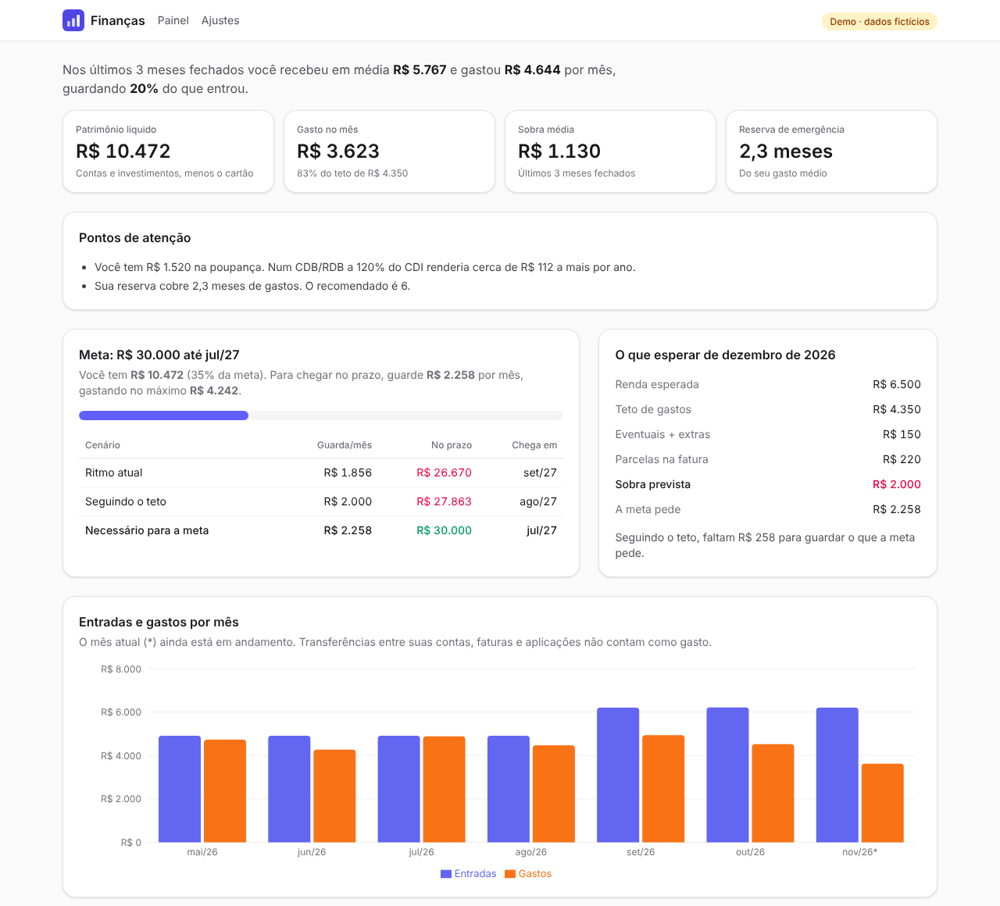

# Finanças · painel pessoal com Open Finance

Painel de finanças pessoais que lê contas, cartão e investimentos pelo **Open Finance** (via [Pluggy](https://pluggy.ai)) e responde às perguntas que importam no mês a mês:

- **Quanto estou gastando, e em quê?** Categorização automática por regras, com correções feitas pela própria pessoa.
- **Estou dentro do teto?** Teto por categoria contra o gasto do mês e a média dos últimos 3 meses.
- **Chego na minha meta?** Quanto guardar por mês até o prazo (com rendimento líquido do CDI e gastos extras previstos, como festas) e em que mês cada ritmo chega lá.
- **Onde está meu dinheiro e quanto rende?** Carteira, rendimento por aplicação e alerta de dinheiro parado na poupança.
- **Como está o meu MEI?** Faturamento contra o limite anual, relatório mensal de receitas e estimativa do IR da pessoa física.

> **Demo online:** https://amandazmn.github.io/financas-app/ (dados fictícios; nenhum dado real fica no repositório).



## Stack

| | |
|---|---|
| Framework | Next.js 16 (App Router, Server Components, Proxy) |
| Linguagem | TypeScript (strict) |
| UI | Tailwind CSS 4, Recharts, modo escuro automático |
| Dados | API da Pluggy (Open Finance) ou gerador de dados fictícios |
| Testes | Vitest |
| CI/CD | GitHub Actions: typecheck, testes, build e deploy da demo no GitHub Pages |
| App | PWA instalável no celular e no computador |

## Arquitetura

```
src/
├── lib/finance/      # Regras de negócio puras, sem React e sem I/O (testadas)
│   ├── categorize.ts #   categorização por regras + regras do titular (renda do MEI, transferências)
│   ├── analysis.ts   #   meses, teto, oportunidades de economia, carteira, rendimentos, indicadores
│   ├── plan.ts       #   projeção de 12 meses, meta (anuidade com CDI líquido), próximo mês
│   └── mei.ts        #   faturamento x limite, relatório mensal, estimativa de IR
├── lib/data/         # Fontes de dados (só no servidor)
│   ├── demo.ts       #   dados fictícios com semente fixa
│   └── pluggy.ts     #   cliente mínimo da API da Pluggy (somente leitura)
├── components/       # Dashboard, gráficos e formulário de ajustes (client components)
├── app/              # Páginas: painel, ajustes e /api/snapshot
└── proxy.ts          # Senha (HTTP Basic) quando o modo real está ligado
```

Decisões que vale destacar:

- **Domínio separado da interface.** Todo cálculo financeiro está em `lib/finance`, em funções puras que recebem a data de hoje como parâmetro. Isso deixa os testes determinísticos e a lógica reaproveitável em outro cliente (app nativo, CLI, bot).
- **Servidor busca, cliente calcula.** O servidor normaliza os dados do banco num `Snapshot`; o navegador aplica tetos, metas e regras guardados em `localStorage`. Mudar um teto recalcula tudo na hora, sem nova chamada ao banco.
- **Segredos só no servidor.** As credenciais da Pluggy ficam em variáveis de ambiente e o módulo usa `server-only`. No modo real, o app inteiro fica atrás de senha.
- **Somente leitura.** O cliente da Pluggy só faz `GET` de contas, transações e investimentos.

## Rodando localmente

```bash
npm install
npm run dev        # http://localhost:3000 (modo demo)
npm test           # testes das regras financeiras
npm run build
```

## Usando com as suas contas (Meu Pluggy, gratuito)

1. Crie uma conta em [dashboard.pluggy.ai](https://dashboard.pluggy.ai) e uma aplicação para obter `CLIENT_ID` e `CLIENT_SECRET`.
2. Conecte seus bancos em [meu.pluggy.ai](https://meu.pluggy.ai) e autorize a sua aplicação.
3. Copie os IDs das conexões (*items*).
4. Copie `.env.example` para `.env.local` e preencha:

```bash
DATA_SOURCE=pluggy
PLUGGY_CLIENT_ID=...
PLUGGY_CLIENT_SECRET=...
PLUGGY_ITEM_IDS=item-banco-1,item-banco-2
PLUGGY_BUSINESS_ITEM_ID=item-conta-pj   # opcional, para a seção do MEI
APP_PASSWORD=uma-senha-forte
OWNER_NAME="Seu Nome"                    # reconhece transferências entre suas contas
OWNER_CNPJ=00.000.000/0001-00            # reconhece a renda vinda do seu MEI
```

Os dados ficam em cache por 15 minutos. `GET /api/snapshot?refresh` força uma nova leitura.

## Deploy

**Demo no GitHub Pages (automático).** A cada push na `main`, o workflow `pages.yml` gera uma versão estática só com a demo (`scripts/build-pages.mjs`) e publica em `https://<usuário>.github.io/<repositório>/`. Ela é reconstruída toda segunda para as datas acompanharem o calendário. Para ativar: *Settings → Pages → Source: GitHub Actions*.

**App completo (com servidor).** O modo real precisa de servidor (credenciais da Pluggy, senha e API), então não roda no GitHub Pages. Na Vercel, importe o repositório e configure as variáveis do `.env.example` num projeto privado.

## Limitações

- As regras de categoria são por palavra-chave; descrições muito genéricas caem em "Outros gastos" até você criar uma regra em **Ajustes**.
- Os valores do MEI (limite anual, parte isenta de 32% para serviços, limite para declarar IR) são parâmetros editáveis e devem ser conferidos a cada ano.
- Organização financeira pessoal. Não é recomendação de investimento nem consultoria contábil.

## Licença

MIT
